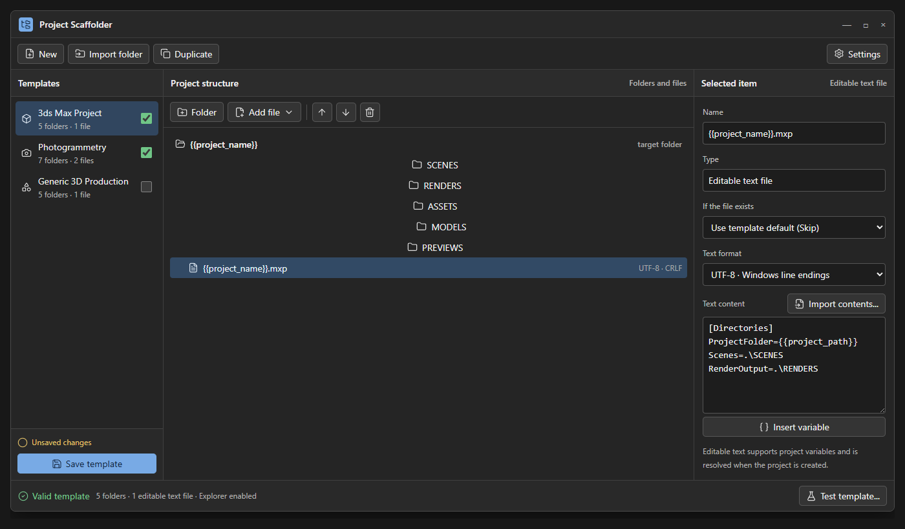

# Project Scaffolder

Project Scaffolder is a Windows 11 utility for building reusable project-folder templates and applying them instantly from the classic File Explorer context menu.



> **Current development version:** `2.0.0-alpha.7` for Windows 11 x64. Alpha installers are unsigned.

## What it does

- Visually builds nested folder structures.
- Adds editable text files with project variables or attaches existing files verbatim.
- Optionally marks newly created folders as hidden.
- Can assign a semantic folder role so related tools can find a destination without depending on its name.
- Registers chosen templates under `New Project` in the classic Explorer context menu.
- Generates directly inside the current folder, silently on success.
- Creates a hidden `.projectID.json` containing a stable UUIDv7 project identity and template provenance.
- Creates a hidden `.projectStructure.json` when a template declares semantic paths such as raw and processed capture destinations.
- Offers RealityScan project, alignment-component, and model-export roles for CLIBuilder defaults through the same semantic-role mechanism.
- Can create or update only `.projectStructure.json` for an existing project after matching its Template ID and verifying every declared role folder.
- Refuses to apply a different template to an already identified project.

The editor and generation engine are generic. A 3ds Max `.mxp`, Maya workspace file, production README, or another text-based project file is simply an editable template file.

## Install

Download the installer from [GitHub Releases](https://github.com/zdravkopavlov/ProjectScaffolder_2.0/releases).

The installer:

- installs per user under `%LOCALAPPDATA%\Programs\ProjectScaffolder`;
- does not require administrator privileges or a separately installed .NET runtime;
- keeps templates and settings under `%LOCALAPPDATA%\ProjectScaffolder`;
- registers the classic Explorer menu for the current user;
- preserves local user data by default during uninstall.

Because the current alpha installer is not digitally signed, Windows may display a publisher warning. Verify the SHA-256 value shown in the corresponding GitHub release before running it.

## Basic workflow

1. Open Project Scaffolder and create or edit a template.
2. Build its folder tree, optionally add files, and assign any required semantic destinations to the appropriate folders.
3. Enable the checkbox beside the template to register it in Explorer.
4. Create and name an empty project folder, then enter it.
5. Right-click empty space and choose `New Project` followed by the template name.

Successful generation does not show a confirmation dialog.

For an existing project created from the selected saved template, **Update metadata…** chooses the project folder and creates or updates only `.projectStructure.json`. It does not create folders or reapply template files. The operation refuses missing role folders, invalid metadata, reparse points, and a different recorded Template ID.

CLIBuilder integration is specified in [`CLIBUILDER-CONTRACT.md`](CLIBUILDER-CONTRACT.md). RawEqualizer's existing `capture.raw` and `capture.processed` roles remain unchanged.

## Build from source

Requirements:

- Windows 11 x64
- .NET SDK 10.0.400 or a compatible later patch in that feature band
- Inno Setup 6 to build the installer

```powershell
dotnet restore ProjectScaffolder.sln
dotnet test ProjectScaffolder.sln -c Release --no-restore
powershell -ExecutionPolicy Bypass -File scripts\Build-Installer.ps1
```

The installer is written to `artifacts\installer`, which is intentionally excluded from Git.

## Documentation

- [Product design and milestone record](DESIGN.md)
- [JSON contract](JSON-CONTRACT.md)
- [CLIBuilder integration contract](CLIBUILDER-CONTRACT.md)
- [Installer build notes](installer/README.md)
- [Template and project schemas](schemas)

## Privacy and safety

Project Scaffolder runs locally and does not require an account or cloud service. Generation validates paths before writing, reuses existing folders, skips existing files by default, and uses conservative rollback when an operation fails.

## License

Project Scaffolder is released under the [MIT License](LICENSE). Third-party components and artwork are documented in [THIRD-PARTY-NOTICES.md](THIRD-PARTY-NOTICES.md).
